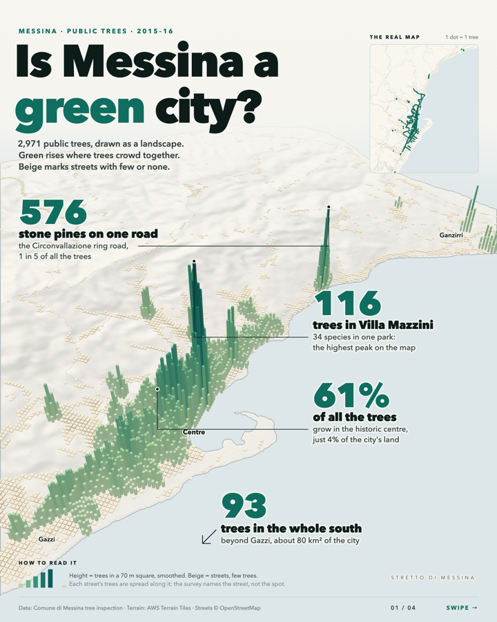
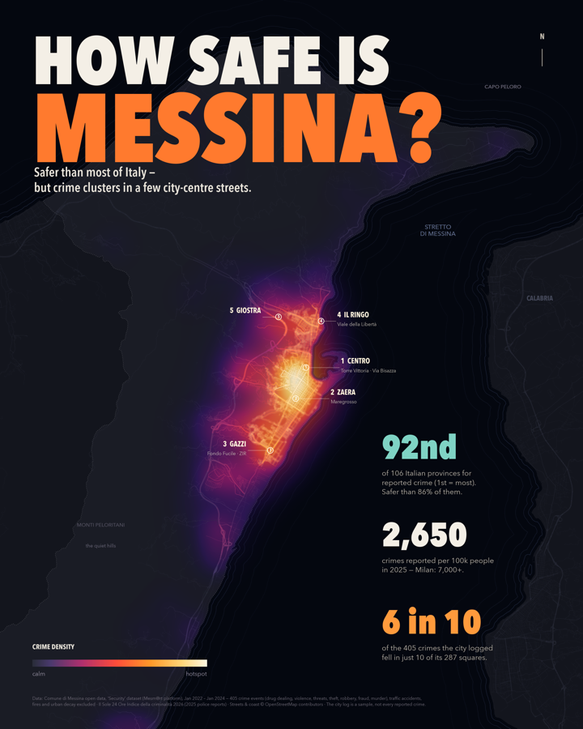
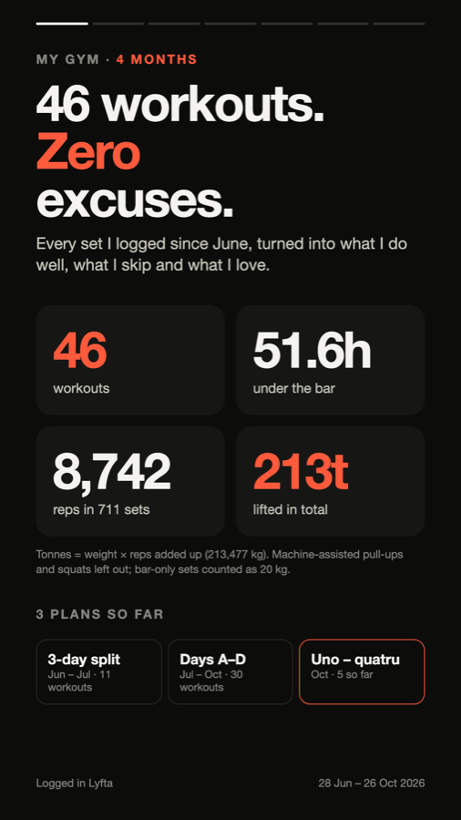

  <h1>Hi, I'm Ahmed Faraz Palijo 👋</h1>
  
   
  

---

### 🧠 About me

Hi everyone, I am a Data Analysis student at the **University of Messina** with a high level of interest in Artificial Intelligence. I like turning data into visuals (especially maps where applicable), to help get a bigger picture of what exactly went on, and to facilitate decision making. I use tools like Tableau for it.

I source the data, clean it up and turn it into something which is pleasing on the eye to look at.

---

### 🎨 Data stories

<table>
  <tr>
    <td width="33%" align="center" valign="top">
       
      <b>Is Messina a green city?</b> 
      2,971 public trees mapped as a 3D landscape
    </td>
    <td width="33%" align="center" valign="top">
       
      <b>How safe is Messina?</b> 
      Three years of city crime data as a heat map
    </td>
    <td width="33%" align="center" valign="top">
       
      <b>46 workouts, zero excuses</b> 
      Four months of my own gym logs as a story
    </td>
  </tr>
</table>

### 🚀 Projects

  
  
  

---

### 🛠️ Tools I use

  
  
  
  
  
  
  
  
  
  
  
  
  
  <img src="https://img.shields.io/badge/VS_Code-1E1E1E?style=flat&logo=data:image/svg%2bxml;base64,PHN2ZyB4bWxucz0iaHR0cDovL3d3dy53My5vcmcvMjAwMC9zdmciIHZpZXdCb3g9IjAgMCAxMjggMTI4Ij48bWFzayBpZD0iYSIgd2lkdGg9IjEyOCIgaGVpZ2h0PSIxMjgiIHg9IjAiIHk9IjAiIG1hc2tVbml0cz0idXNlclNwYWNlT25Vc2UiIHN0eWxlPSJtYXNrLXR5cGU6YWxwaGEiPjxwYXRoIGZpbGw9IiNmZmYiIGZpbGwtcnVsZT0iZXZlbm9kZCIgZD0iTTkwLjc2NyAxMjcuMTI2YTcuOTY4IDcuOTY4IDAgMCAwIDYuMzUtLjI0NGwyNi4zNTMtMTIuNjgxYTggOCAwIDAgMCA0LjUzLTcuMjA5VjIxLjAwOWE4IDggMCAwIDAtNC41My03LjIxTDk3LjExNyAxLjEyYTcuOTcgNy45NyAwIDAgMC05LjA5MyAxLjU0OGwtNTAuNDUgNDYuMDI2TDE1LjYgMzIuMDEzYTUuMzI4IDUuMzI4IDAgMCAwLTYuODA3LjMwMmwtNy4wNDggNi40MTFhNS4zMzUgNS4zMzUgMCAwIDAtLjAwNiA3Ljg4OEwyMC43OTYgNjQgMS43NCA4MS4zODdhNS4zMzYgNS4zMzYgMCAwIDAgLjAwNiA3Ljg4N2w3LjA0OCA2LjQxMWE1LjMyNyA1LjMyNyAwIDAgMCA2LjgwNy4zMDNsMjEuOTc0LTE2LjY4IDUwLjQ1IDQ2LjAyNWE3Ljk2IDcuOTYgMCAwIDAgMi43NDMgMS43OTNabTUuMjUyLTkyLjE4M0w1Ny43NCA2NGwzOC4yOCAyOS4wNThWMzQuOTQzWiIgY2xpcC1ydWxlPSJldmVub2RkIi8%2BPC9tYXNrPjxnIG1hc2s9InVybCgjYSkiPjxwYXRoIGZpbGw9IiMwMDY1QTkiIGQ9Ik0xMjMuNDcxIDEzLjgyIDk3LjA5NyAxLjEyQTcuOTczIDcuOTczIDAgMCAwIDg4IDIuNjY4TDEuNjYyIDgxLjM4N2E1LjMzMyA1LjMzMyAwIDAgMCAuMDA2IDcuODg3bDcuMDUyIDYuNDExYTUuMzMzIDUuMzMzIDAgMCAwIDYuODExLjMwM2wxMDMuOTcxLTc4Ljg3NWMzLjQ4OC0yLjY0NiA4LjQ5OC0uMTU4IDguNDk4IDQuMjJ2LS4zMDZhOC4wMDEgOC4wMDEgMCAwIDAtNC41MjktNy4yMDhaIi8%2BPGcgZmlsdGVyPSJ1cmwoI2IpIj48cGF0aCBmaWxsPSIjMDA3QUNDIiBkPSJtMTIzLjQ3MSAxMTQuMTgxLTI2LjM3NCAxMi42OThBNy45NzMgNy45NzMgMCAwIDEgODggMTI1LjMzM0wxLjY2MiA0Ni42MTNhNS4zMzMgNS4zMzMgMCAwIDEgLjAwNi03Ljg4N2w3LjA1Mi02LjQxMWE1LjMzMyA1LjMzMyAwIDAgMSA2LjgxMS0uMzAzbDEwMy45NzEgNzguODc0YzMuNDg4IDIuNjQ3IDguNDk4LjE1OSA4LjQ5OC00LjIxOXYuMzA2YTguMDAxIDguMDAxIDAgMCAxLTQuNTI5IDcuMjA4WiIvPjwvZz48ZyBmaWx0ZXI9InVybCgjYykiPjxwYXRoIGZpbGw9IiMxRjlDRjAiIGQ9Ik05Ny4wOTggMTI2Ljg4MkE3Ljk3NyA3Ljk3NyAwIDAgMSA4OCAxMjUuMzMzYzIuOTUyIDIuOTUyIDggLjg2MSA4LTMuMzE0VjUuOThjMC00LjE3NS01LjA0OC02LjI2Ni04LTMuMzEzYTcuOTc3IDcuOTc3IDAgMCAxIDkuMDk4LTEuNTQ5TDEyMy40NjcgMTMuOEE4IDggMCAwIDEgMTI4IDIxLjAxdjg1Ljk4MmE4IDggMCAwIDEtNC41MzMgNy4yMWwtMjYuMzY5IDEyLjY4MVoiLz48L2c%2BPHBhdGggZmlsbD0idXJsKCNkKSIgZmlsbC1ydWxlPSJldmVub2RkIiBkPSJNOTAuNjkgMTI3LjEyNmE3Ljk2OCA3Ljk2OCAwIDAgMCA2LjM0OS0uMjQ0bDI2LjM1My0xMi42ODFhOCA4IDAgMCAwIDQuNTMtNy4yMVYyMS4wMDlhOCA4IDAgMCAwLTQuNTMtNy4yMUw5Ny4wMzkgMS4xMmE3Ljk3IDcuOTcgMCAwIDAtOS4wOTMgMS41NDhsLTUwLjQ1IDQ2LjAyNi0yMS45NzQtMTYuNjhhNS4zMjggNS4zMjggMCAwIDAtNi44MDcuMzAybC03LjA0OCA2LjQxMWE1LjMzNiA1LjMzNiAwIDAgMC0uMDA2IDcuODg4TDIwLjcxOCA2NCAxLjY2MiA4MS4zODZhNS4zMzUgNS4zMzUgMCAwIDAgLjAwNiA3Ljg4OGw3LjA0OCA2LjQxMWE1LjMyOCA1LjMyOCAwIDAgMCA2LjgwNy4zMDNsMjEuOTc1LTE2LjY4MSA1MC40NSA0Ni4wMjZhNy45NTkgNy45NTkgMCAwIDAgMi43NDIgMS43OTNabTUuMjUyLTkyLjE4NEw1Ny42NjIgNjRsMzguMjggMjkuMDU3VjM0Ljk0M1oiIGNsaXAtcnVsZT0iZXZlbm9kZCIgb3BhY2l0eT0iMC4yNSIgc3R5bGU9Im1peC1ibGVuZC1tb2RlOm92ZXJsYXkiLz48L2c%2BPGRlZnM%2BPGZpbHRlciBpZD0iYiIgd2lkdGg9IjE0NC43NDQiIGhlaWdodD0iMTEzLjQwOCIgeD0iLTguNDExMTUiIHk9IjIyLjU5NDQiIGNvbG9yLWludGVycG9sYXRpb24tZmlsdGVycz0ic1JHQiIgZmlsdGVyVW5pdHM9InVzZXJTcGFjZU9uVXNlIj48ZmVGbG9vZCBmbG9vZC1vcGFjaXR5PSIwIiByZXN1bHQ9IkJhY2tncm91bmRJbWFnZUZpeCIvPjxmZUNvbG9yTWF0cml4IGluPSJTb3VyY2VBbHBoYSIgcmVzdWx0PSJoYXJkQWxwaGEiIHZhbHVlcz0iMCAwIDAgMCAwIDAgMCAwIDAgMCAwIDAgMCAwIDAgMCAwIDAgMTI3IDAiLz48ZmVPZmZzZXQvPjxmZUdhdXNzaWFuQmx1ciBzdGREZXZpYXRpb249IjQuMTY2NjciLz48ZmVDb2xvck1hdHJpeCB2YWx1ZXM9IjAgMCAwIDAgMCAwIDAgMCAwIDAgMCAwIDAgMCAwIDAgMCAwIDAuMjUgMCIvPjxmZUJsZW5kIGluMj0iQmFja2dyb3VuZEltYWdlRml4IiBtb2RlPSJvdmVybGF5IiByZXN1bHQ9ImVmZmVjdDFfZHJvcFNoYWRvd18xXzM2Ii8%2BPGZlQmxlbmQgaW49IlNvdXJjZUdyYXBoaWMiIGluMj0iZWZmZWN0MV9kcm9wU2hhZG93XzFfMzYiIHJlc3VsdD0ic2hhcGUiLz48L2ZpbHRlcj48ZmlsdGVyIGlkPSJjIiB3aWR0aD0iNTYuNjY2NyIgaGVpZ2h0PSIxNDQuMDA3IiB4PSI3OS42NjY3IiB5PSItOC4wMDM1IiBjb2xvci1pbnRlcnBvbGF0aW9uLWZpbHRlcnM9InNSR0IiIGZpbHRlclVuaXRzPSJ1c2VyU3BhY2VPblVzZSI%2BPGZlRmxvb2QgZmxvb2Qtb3BhY2l0eT0iMCIgcmVzdWx0PSJCYWNrZ3JvdW5kSW1hZ2VGaXgiLz48ZmVDb2xvck1hdHJpeCBpbj0iU291cmNlQWxwaGEiIHJlc3VsdD0iaGFyZEFscGhhIiB2YWx1ZXM9IjAgMCAwIDAgMCAwIDAgMCAwIDAgMCAwIDAgMCAwIDAgMCAwIDEyNyAwIi8%2BPGZlT2Zmc2V0Lz48ZmVHYXVzc2lhbkJsdXIgc3RkRGV2aWF0aW9uPSI0LjE2NjY3Ii8%2BPGZlQ29sb3JNYXRyaXggdmFsdWVzPSIwIDAgMCAwIDAgMCAwIDAgMCAwIDAgMCAwIDAgMCAwIDAgMCAwLjI1IDAiLz48ZmVCbGVuZCBpbjI9IkJhY2tncm91bmRJbWFnZUZpeCIgbW9kZT0ib3ZlcmxheSIgcmVzdWx0PSJlZmZlY3QxX2Ryb3BTaGFkb3dfMV8zNiIvPjxmZUJsZW5kIGluPSJTb3VyY2VHcmFwaGljIiBpbjI9ImVmZmVjdDFfZHJvcFNoYWRvd18xXzM2IiByZXN1bHQ9InNoYXBlIi8%2BPC9maWx0ZXI%2BPGxpbmVhckdyYWRpZW50IGlkPSJkIiB4MT0iNjMuOTIyMiIgeDI9IjYzLjkyMjIiIHkxPSIwLjMyOTkwMiIgeTI9IjEyNy42NyIgZ3JhZGllbnRVbml0cz0idXNlclNwYWNlT25Vc2UiPjxzdG9wIHN0b3AtY29sb3I9IiNmZmYiLz48c3RvcCBvZmZzZXQ9IjEiIHN0b3AtY29sb3I9IiNmZmYiIHN0b3Atb3BhY2l0eT0iMCIvPjwvbGluZWFyR3JhZGllbnQ%2BPC9kZWZzPjwvc3ZnPgo%3D" alt="VS Code" />
  
  
  

---

<i>Open to internships and data projects. Let's connect!</i>

